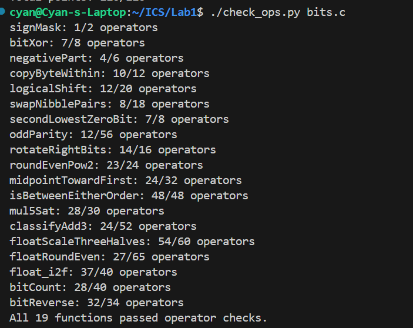
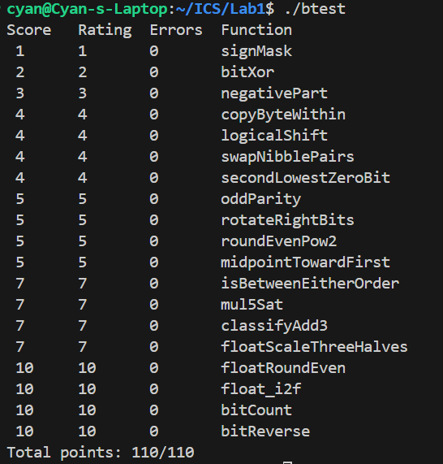

# Lab 1：Data Lab 实验报告

**姓名**：陈钰泉
**学号**：24307090037
**实验标题**：Lab 1 — Data Lab

---

## 1. 实验结果

### 1.1 运算符和操作数检查

我在终端里执行 `./check_ops.py bits.c`，19 道题全部通过：



### 1.2 正确性测试

然后执行 `./btest`，每一题的 Errors 都是 0：



```text
Total points: 110/110
```

---

## 2. 各函数的实现思路

### P1 `signMask` — 返回 `0x80000000`

```c
int signMask(void) {
  return 1 << 31;
}
```

返回值必须正好是 `0x80000000`，也就是只有 bit31 是 1。规则里整数常量只能写 0–255，所以不能直接写这个大数。

我的做法是把 `1` 左移 31 位。`1` 的位模式是 `...0001`，左移 31 位后那个 1 就正好落在最高位。题目里说左移是按 32 位位向量解释、允许移进符号位，所以这么写是安全的，而且只用了 1 个运算符（上限 2）。

### P2 `bitXor` — 只用 `~` 和 `&` 实现异或

```c
int bitXor(int x, int y) {
  return ~(x & y) & ~(~x & ~y);
}
```

这题只能写 `~` 和 `&`，连 `|` 都不能用，所以关键是用德摩根律把「或」换掉：

```text
x ^ y = (x & ~y) | (~x & y) = ~( ~(x & ~y) & ~(~x & y) )
```

我最后用的是更省运算符的写法：`~(x & y)` 能把「两位都是 1」的情况排除掉，`~(~x & ~y)` 能把「两位都是 0」的情况排除掉，两者再与一下，剩下的就正好是「两位不同」的情况。这样是 7 个运算符，上限是 8。

### P3 `negativePart` — x 小于 0 时返回 -x，否则返回 0

```c
int negativePart(int x){
  return (x >> 31) & (~x + 1);
}
```

这题要解决两件事：判断正负，以及求相反数。

判正负我用了算术右移：`x >> 31` 在 x 是负数的时候会得到全 1，非负的时候得到全 0，正好可以直接当掩码用，比先取符号位再取反省操作数。

求相反数用的是补码的恒等式 `-x = ~x + 1`。最后用掩码去乘：x 是负数就把 `~x+1` 留下，非负就全被清成 0，等于代替了 `if`。

`INT_MIN` 这个边界也没问题：`~INT_MIN + 1` 会回绕成 `INT_MIN`，和参考实现 `x < 0 ? -x : 0` 的溢出行为是一致的。

### P4 `copyByteWithin` — 把第 src 个字节复制到第 dst 个字节

```c
int copyByteWithin(int x, int src, int dst) {
  int byte = (x >> (src << 3)) & 0xFF;
  int mask = 0xFF << (dst << 3);
  return (x & ~mask) | (byte << (dst << 3));
}
```

字节编号要换成位偏移需要乘 8，乘法不能用，就写成 `<< 3`。

取源字节的时候先右移到最低字节，再 `& 0xFF`。这个 `& 0xFF` 有两个作用：一是把算术右移带进来的符号位切掉，二是把不需要的高字节切掉。

改一段位的时候要先清后或。如果直接 `x | (byte << ...)`，目标字节里原来是 1、而源字节是 0 的那些位不会被清掉，所以必须先 `x & ~mask` 把目标字节清零。

### P5 `logicalShift` — 逻辑右移

```c
int logicalShift(int x, int n) {
  int mask = (~0 << ((33 + ~n) & 31)) & (!n + ~0);
  return (x >> n) & ~mask;
}
```

C 里 `int` 的 `>>` 是算术右移，负数高位会补符号位，但逻辑右移要求补 0。我的思路是先照常做算术右移，然后把高位多补出来的 n 位掩掉。

要掩掉的掩码是「高 n 位全 1」，也就是移位量等于 `32 - n`。用 `~` 表示就是 `33 + ~n`（因为 `~n = -n-1`，所以 `33 + ~n = 32 - n`），再 `& 31` 防止移位量越界。

n = 0 是这题唯一要小心的地方：这时 `(33 + ~0) & 31` 等于 `32 & 31 = 0`，`~0 << 0` 得到全 1，会把整个结果都清成 0。所以我加了 `& (!n + ~0)`：n = 0 时 `!n + ~0` 是 0，掩码被清掉；n ≥ 1 时它是全 1，掩码保持原样。

### P6 `swapNibblePairs` — 交换每个字节内的高低位半字节

```c
int swapNibblePairs(int x) {
  int m  = 0x0F | (0x0F << 8);
  m = m | (m << 16);
  int lo = x & m;
  int hi = x & ~m;
  return (lo << 4) | ((hi >> 4) & m);
}
```

这题的关键是先造出交替掩码 `0x0F0F0F0F`，让每个字节内部的位段被隔开。

`0x0F0F0F0F` 超过 255 不能直接写，所以要拼出来：先用 `0x0F | (0x0F << 8)` 得到 `0x00000F0F`，再 `m | (m << 16)` 铺满 32 位。

低位半字节左移 4 位正好进入同一个字节的高半字节位置，高半字节右移 4 位进入低半字节位置。移位之后必须再 `& m` 一次，否则相邻字节的位会串过来。

### P7 `secondLowestZeroBit` — 第二低的 0 位

```c
int secondLowestZeroBit(int x) {
  int first = (~x) & (x + 1);
  int used  = x | first;
  return (~used) & (used + 1);
}
```

我先解决一个子问题：怎么求最低的 0 位。`x + 1` 的加法进位会从最低位一路进位，遇到第一个 0 位就把它翻成 1 然后停下；`~x` 在这些高位上跟 x 是相反的，两者相与之后，只有那个位置会留下来，所以 `(~x) & (x + 1)` 就是最低的 0 位。

然后「占掉」这个位置：`used = x | first` 把它置成 1，再对 `used` 求一次最低的 0 位，得到的就是原来 x 的第二低 0 位。

如果 x 是全 1，那 `~used` 直接是 0，结果自然返回 0，不需要特别判断。

### P8 `oddParity` — 奇校验位（1 的个数为偶数时返回 1）

```c
int oddParity(int x) {
  int p = x ^ (x >> 16);
  p = p ^ (p >> 8);
  p = p ^ (p >> 4);
  p = p ^ (p >> 2);
  p = p ^ (p >> 1);
  return ~p & 1;
}
```

用到的是异或「两两抵消」的性质：把所有位异或起来，成对的 1 会互相抵消，最后剩下的就是 1 的个数的奇偶性。

不用一位一位算，用折半的方式压缩：16 → 8 → 4 → 2 → 1，5 步就够了。

题目要的是「偶数个 1 返回 1」，跟异或的结果正好相反，所以最后取反。这里必须带 `& 1`，不然返回的是 `0xFFFFFFFE` 这种掩码而不是 1。

### P9 `rotateRightBits` — 循环右移

```c
int rotateRightBits(int x, int n) {
  int s = n & 31;
  int m = (1 << 31) + ~0;                 /* 0x7FFFFFFF（正数） */
  int mask = ((m >> s) << 1) | 1;         /* 低 32-s 位全 1 的掩码 */
  int right = (x >> s) & mask;            /* 逻辑右移部分 */
  int left  = x << ((~s + 1) & 31);       /* 循环回来的部分 */
  return right | left;
}
```

循环右移等于「逻辑右移」加上「把移出去的低位接到高位」。

首先移位量要先取模。这题只保证 n ≥ 0，测试里还出现了 `n = 2147483647`，所以要用 `s = n & 31`。

逻辑右移需要一个「低 32-s 位全 1」的掩码。这里不能用 `~0 >> s`，因为 `~0` 是 -1（负数），算术右移永远得到全 1，必须用一个正数 `0x7FFFFFFF` 去右移，高位才会补 0。另外直接 `m >> s` 在 s = 0 的时候会丢掉 bit31，所以我写成 `((m >> s) << 1) | 1` 把它补回来。

左移量应该是 `(32 - s) mod 32`。这里要注意不能写成 `(32 + ~s) & 31`，它在 s = 0 和 s = 31 的时候都是错的（分别得到 31 和 0），正确写法是 `(~s + 1) & 31`，也就是 `(-s) & 31`。

### P10 `roundEvenPow2` — 舍入到最近的 2^n 倍数（中点取偶）

```c
int roundEvenPow2(int x, int n) {
  int q = x >> n;
  int block = 1 << n;
  int r = x & (block + ~0);
  int d = r + ~((block >> 1) + ~0);
  int nz = ((d | (~d + 1)) >> 31) & 1;
  int carry = ((d >> 31) ^ 1) & (nz | ((nz ^ 1) & q));
  return (q + carry) << n;
}
```

参考实现的逻辑是：算出商 q、余数 r 和半数 half，如果 r > half，或者 r == half 且 q 是奇数，就把 q 加一。

我用位运算来实现这几步：`q = x >> n`，`r = x & (2^n - 1)`（`2^n - 1` 写成 `block + ~0`），`half = block >> 1`。

判断 r 和 half 的大小关系，我用一个减法的符号位来压缩：令 `d = r - half`，那么 d < 0 表示 r < half，d == 0 表示正好在中点，d > 0 表示 r > half。

`nz` 用来判断 d 是不是 0（用 `(d | -d) >> 31` 这个零测试）。进位条件是：d > 0 一定进位；d == 0 的时候看 q 的最低位（奇偶）；d < 0 不进位。

要特别小心 half 的写法。`block / 2` 我用的是 `block >> 1`，如果写成 `1 << (n - 1)` 就要把 `n - 1` 写成 `n + ~0`，很容易多减一次少减一次（`~0` 本身就是 -1）。

### P11 `midpointTowardFirst` — 无溢出求中点，中点偏向第一个参数

```c
int midpointTowardFirst(int x, int y) {
  int half = (x & y) + ((x ^ y) >> 1);
  int odd  = (x ^ y) & 1;
  int sx = (x >> 31) & 1, sy = (y >> 31) & 1;
  int diffSign = ((x + ~y + 1) >> 31) & 1;
  int opposite = sx ^ sy;
  int xGreater = (opposite & (sx ^ 1)) | ((opposite ^ 1) & (diffSign ^ 1));
  return half + (odd & xGreater);
}
```

`(x + y) / 2` 不能直接写，因为 x 和 y 都是 `INT_MAX` 时会溢出。所以用无溢出求平均的恒等式：

```text
floor((x + y) / 2) = (x & y) + ((x ^ y) >> 1)
```

它的道理是按位拆成「公共的 1」和「只有一个 1 的位」，这两部分各自都不会溢出。

判断奇偶：`x + y` 是奇数等价于两个最低位不同，也就是 `(x ^ y) & 1`。

中点方向：和为奇数且 x > y 时，结果要加 1（更靠近 x）；x < y 时不用加。

判断 x > y 这里要小心，`x - y` 会溢出。我的做法是**只在同号的时候用差值的符号，异号的时候直接看 x 的符号**。另外把 0/1 取反要用 `^ 1`，不能用 `~`（`~1` 是 -2，不是 0）。

### P12 `isBetweenEitherOrder` — 判断 x 是否在 [a, b] 内（端点顺序不定）

```c
int isBetweenEitherOrder(int x, int a, int b) {
  int sa = a >> 31, sb = b >> 31, sx = x >> 31;
  int nsa = ~sa, nsx = ~sx, nsb = ~sb;
  int dAX = x + ~a + 1, dXB = b + ~x + 1;      /* x-a, b-x */
  int mAX = (sa ^ sx) >> 31, mXB = (sb ^ sx) >> 31;
  int ax = (~(mAX | (dAX >> 31))) | (mAX & sa & nsx);            /* a <= x */
  int xa = (~(mAX | (((~dAX) + 1) >> 31))) | (mAX & sx & nsa);   /* x <= a */
  int xb = (~(mXB | (dXB >> 31))) | (mXB & sx & nsb);            /* x <= b */
  int bx = (~(mXB | (((~dXB) + 1) >> 31))) | (mXB & sb & nsx);   /* b <= x */
  return ((ax & xb) | (bx & xa)) & 1;
}
```

x 在区间内等价于「a ≤ x 且 x ≤ b」或者「b ≤ x 且 x ≤ a」，所以要比较 4 次。核心是写一个溢出安全的 `le(P, Q)`（判断 P ≤ Q）：

```text
m = (P ^ Q) >> 31        异号时是 -1（全 1 掩码），同号时是 0
d = Q - P
同号（m = 0）   : P ≤ Q 等价于 d ≥ 0
异号（m = -1）  : P ≤ Q 等价于 P 是负数且 Q 非负
le = (~m & ~(d >> 31)) | (m & (P >> 31) & ~(Q >> 31))
```

这里的 `m` 是关键。`(P ^ Q) >> 31` 在异号的时候得到 -1，正好可以当「异号掩码」用。`~(m | (d >> 31))` 是把两个取反和一个与合并起来写，能省操作数。

还有一点：`d` 的方向必须严格是「第二个参数减第一个参数」。我一开始想反向调用的时候用 `-d` 反推，但那样平局和边界的语义会反过来，所以最后老老实实算 4 个差值。

最后把 0/1 的归一化推迟到最后统一 `& 1`，每个 `le` 的结果不单独归一化，这样省了 3 个操作数。

这题的上限是 48，我刚好用满。我的顺序是：先把四种比较的逻辑写对、让 `btest` 通过，再一点点把运算符数量压到上限以内。

### P13 `mul5Sat` — x*5 溢出时饱和到 INT_MAX 或 INT_MIN

```c
int mul5Sat(int x) {
  int s = x >> 31;
  int mag = (x ^ s) + (s & 1);
  int s1 = 0x66 | (0x66 << 8);
  int K = s1 | (s1 << 16);                 /* 0x66666666 */
  int sat = (mag + K) >> 31;
  int nz = (sat | (~sat + 1)) >> 31;
  int lo = (1 << 31) + ~0;
  int hi = 1 << 31;
  int val = (lo & ~s) | (hi & s);
  int p = x + (x << 2);
  return (p & ~nz) | (val & nz);
}
```

乘法不能用，`x * 5` 写成 `x + (x << 2)`。

求 `|x|` 我用的是无分支写法：`s = x >> 31`，`mag = (x ^ s) + (s & 1)`。x 是负数时它是 `~x + 1`，非负时就是 x。`INT_MIN` 也成立。

这题的难点是饱和的阈值。边界不是 2 的整数次幂，我一开始估错了，`btest` 直接报错。后来我把 `btest` 报错的那个 x 值前后几个数都手动试了一遍，把临界点找出来，发现两侧都是 `|x| ≥ 429496730`（也就是 `⌈2^31 / 5⌉`）。然后把「mag ≥ 429496730」转成一次加法的符号位：只要 `mag + K ≥ 2^31` 就饱和，其中 `K = 2^31 - 429496730 = 0x66666666`。

`0x66666666` 也是超过 255 的常量，我用 `0x66 | (0x66 << 8)` 再自复制到高 16 位拼出来。

这里有个坑：只判断「符号翻转」是不够的。在 (429496729, 536870911] 这一段，5x 回绕之后的符号并没有变，但已经越界了，所以必须用阈值比较。

饱和值同样用掩码选：`(0x7fffffff & ~s) | (0x80000000 & s)`。

### P14 `classifyAdd3` — 给精确和 x+y+z 分类

```c
int classifyAdd3(int x, int y, int z) {
  int sx = x >> 31, sy = y >> 31, sz = z >> 31;
  int ax = ~sx, ay = ~sy, az = ~sz;

  int s1 = x + y, ss1 = s1 >> 31;
  int c1 = (ax & ay) | ((ax ^ ay) & ~ss1);

  int m  = 1 << 31;
  int bz = z ^ m;                          /* 把 z 的第 31 位翻转 */
  int s2 = s1 + bz, ss2 = s2 >> 31;
  int c2 = (ss1 & az) | ((ss1 ^ az) & ~ss2);

  return ~(c1 + c2);
}
```

这题是我卡最久的一题，最后想通的关键是**不要试图去还原那个 34 位的和**。

先说我卡在哪：`x+y+z` 的范围是 `[3·INT_MIN, 3·INT_MAX]`，需要大约 34 位。我一开始想用「x+y 的回绕值 + 两次回绕标志」来还原真实和的高位，但发现信息不够。比如 `(INT_MAX, INT_MAX, INT_MIN)` 这两次加法都回绕了，但恰好互相抵消，真实和是 2147483646，在范围内。所以光看两个回绕标志判断不了方向。

最后的解法有几个点：

第一，`z ^ (1 << 31)`。因为 `2^31` 的最高位是 1，翻转 z 的符号位就等价于给 z 加上 `2^31`。所以 `s2 = s1 + (z ^ 2^31)` 实际算的是 `x + y + z + 2^31`。这样一来，**`s2` 的符号位 `ss2` 就直接告诉我们和有没有低于 INT_MIN**：如果 `ss2 < 0`，说明 `x + y + z < -2^31`。

第二，`c1` 和 `c2` 是两个「修正位」（取值是 0 或者全 1）。它们检查两次加法是否发生了「同号相加却变号」的溢出：`c1` 用 x、y 的非负标志和 s1 的符号；`c2` 用 ss1、z 的非负标志和 ss2 的符号。

第三，最后 `~(c1 + c2)` 就是答案。因为 c1、c2 是 0 或 -1：

| `c1` | `c2` | `c1+c2` | `~(c1+c2)` | 含义 |
|---|---|---|---|---|
| 0 | 0 | 0 | **-1** | 和 < INT_MIN |
| 0 | -1 | -1 | **0** | 在范围内 |
| -1 | 0 | -1 | **0** | 在范围内 |
| -1 | -1 | -2 | **1** | 和 > INT_MAX |

正好就是题目要的三分类，而且整个过程没有用到任何比较运算符，一共 24 个运算符（上限 52）。

说实话，这个「加一个 2^31 偏移」的角度我自己没想到，是问了 GPT 之后才豁然开朗的。我在 `btest` 里单独试了 `(INT_MAX, INT_MAX, INT_MIN)`、`(INT_MAX, INT_MAX, 1)`、`(INT_MIN, INT_MIN, INT_MIN)` 这几组边界，确认都对。

### P15 `floatScaleThreeHalves` — 返回 f * 1.5f 的位级结果

```c
unsigned floatScaleThreeHalves(unsigned uf) {
  unsigned sign = uf & 0x80000000u;
  unsigned exp  = (uf >> 23) & 0xFFu;
  unsigned frac = uf & 0x7FFFFFu;

  if (exp == 0xFFu) return uf;              /* NaN / Inf：原样返回 */
  if (exp == 0 && frac == 0) return sign;   /* ±0：保留符号 */

  /* 值 = m * 2^(et - 150)（et 可为负，用无符号回绕表示） */
  unsigned m  = (exp == 0) ? frac : (frac | 0x800000u);
  unsigned et = (exp == 0) ? (0u + ~150u + 1u) : (exp + ~151u + 1u);

  unsigned t = m * 3u;                      /* 1.5 倍 = 3m */
  if (t >= 0x1000000u) {
    unsigned k = (t >= 0x2000000u) ? 2u : 1u;
    unsigned q = t >> k;
    unsigned rem = t & ((1u << k) - 1u);
    unsigned half = 1u << (k - 1u);
    if (rem > half || (rem == half && (q & 1u))) q++;   /* 就近舍入到偶数 */
    t = q; et += k;
    if (t >= 0x1000000u) { t >>= 1; et++; }
  }
  while (t < 0x800000u) { t <<= 1; et--; }

  unsigned expf = et + 150u;
  if (expf != 0u && expf < 0x80000000u) {
    if (expf >= 255u) return sign | 0x7F800000u;        /* 上溢到 Inf */
    return sign | (expf << 23) | (t & 0x7FFFFFu);       /* 规格化 */
  }
  unsigned sh = ~et + ~148u + 1u;                       /* 下溢：右移量 */
  unsigned q = (sh >= 32u) ? 0u : (t >> sh);
  if (sh >= 1u && sh <= 32u) {
    unsigned rem = (sh >= 32u) ? t : (t & ((1u << sh) - 1u));
    unsigned half = 1u << (sh - 1u);
    if (rem > half || (rem == half && (q & 1u))) q++;
  }
  return sign | q;
}
```

`1.5f` 等于 `3/2`，所以我的思路是：先算出**精确的** `3m`（m 是 24 位有效数，乘 3 不会丢位），再把「乘 3 带来的位数增长」用指数记下来。

具体是先把 sign / exp / frac 拆开。exp 是 0xFF 的时候 NaN 和 Inf 都原样返回，±0 保留符号。有效数 `m = frac | 0x800000`（规格化）或者 `m = frac`（非规格化）。

指数我用一个非负标量 `et` 记账，负值靠无符号回绕表示（这题也禁 cast）。舍入用的是就近舍入到偶数：`t` 可能是 25 位或 26 位，丢掉 k 位的时候用 `rem` 和 `half = 2^(k-1)` 比较，正好一半的时候看保留位的奇偶。进位之后如果又变成 25 位，要再归一一次。

`expf = et + 150` 是阶码域。`expf` 回绕成很大的数时说明下溢，要右移成非规格化并同样做舍入；`expf >= 255` 时上溢到 Inf。

这题我踩的坑全在「位数账目」上：`et` 的基准写错过、`2^(n-1)` 的写法搞错过、`~0` 相当于减一这件事也混淆过。改一次跑一次 `btest`，看它报的是哪个输入、错在指数还是尾数，再顺着改。

### P16 `floatRoundEven` — 舍入到最近的整数（中点取偶）

```c
unsigned floatRoundEven(unsigned uf) {
  unsigned sign = uf & 0x80000000u;
  unsigned exp  = (uf >> 23) & 0xFFu;
  unsigned frac = uf & 0x7FFFFFu;

  if (exp == 0xFFu) return uf;        /* NaN / Inf：原样返回 */
  if (exp >= 150u)  return uf;        /* |f| >= 2^23：已是整数 */
  if (exp < 126u)   return sign;      /* |f| < 0.5：舍入到 ±0（保留符号） */
  if (exp == 126u) {                  /* 0.5 <= |f| < 1 */
    if (frac == 0u) return sign;      /* 恰为 0.5：舍到偶数 0 */
    return sign | (127u << 23);       /* 否则 -> ±1.0f */
  }

  int sh = 150 - exp;                 /* 1..24 */
  unsigned mi  = 0x800000u | frac;
  unsigned q   = mi >> sh;
  unsigned rem = mi & ((1u << sh) - 1u);
  unsigned half = 1u << (sh - 1u);
  if (rem > half || (rem == half && (q & 1u))) q++;

  if (q == 0u) return sign;
  int e = 31;
  while (((q >> e) & 1u) == 0u) e--;
  unsigned mant = q << (23 - e);
  return sign | ((e + 127) << 23) | (mant & 0x7FFFFFu);
}
```

因为 exp 直接就反映 |f| 的量级，所以我按 exp 分段处理：

| exp 范围 | \|f\| 范围 | 处理 |
|---|---|---|
| 0xFF | NaN / Inf | 原样返回 |
| ≥ 150 | ≥ 2^23 | 已经是整数，原样返回 |
| < 126 | < 0.5 | 返回 ±0（保留符号） |
| == 126 | [0.5, 1) | frac == 0 时返回 ±0（中点取偶），否则返回 ±1 |
| 127–149 | [1, 2^23) | 取整 + 就近舍入到偶数，再重新打包成 float |

取整的思路是：把有效数当成整数取出来 `mi = 0x800000 | frac`，右移 `sh = 150 - exp` 位得到整数部分 q，然后把移出去的 rem 和 half 比较做舍入。

最后重新打包：先找到 q 的最高位 e，把 q 左移 `23 - e` 位当尾数，阶码用 `e + 127`。这里不能直接把 q 当尾数，不然指数域会串位。

### P17 `float_i2f` — (float) x 的位级结果

```c
unsigned float_i2f(int x) {
  unsigned ux   = x ^ (x >> 31);              /* 负数按位取反，正数不变 */
  int      neg  = x >> 31;
  unsigned sign = (neg & 1) << 31;
  unsigned a    = ux + (neg & 1);             /* |x| */

  if (a == 0u) return 0u;

  int e = 31;
  while (((a >> e) & 1u) == 0u) e--;

  unsigned mant;
  if (e <= 23) {
    mant = a << (23 - e);
  } else {
    int rsh = e - 23;
    unsigned q    = a >> rsh;
    unsigned rem  = a & ((1u << rsh) - 1u);
    unsigned half = 1u << (rsh - 1);
    if (rem > half || (rem == half && (q & 1u))) q++;
    if (q >= 0x1000000u) { q >>= 1; e++; }   /* 进位则再归一 */
    mant = q & 0x7FFFFFu;
  }
  return sign | ((e + 127) << 23) | (mant & 0x7FFFFFu);
}
```

取绝对值和符号用的是无 cast 的写法：`neg = x >> 31`（负数是 -1），`ux = x ^ neg`，`a = ux + (neg & 1)`。`INT_MIN` 的时候 a 恰好是 `0x80000000`，位模式是对的。

然后找最高有效位 e（这题允许用 while）。如果 e ≤ 23，说明有效位不到 24 位，左移对齐就行，不用舍入；如果 e > 23，就要舍掉低 `e - 23` 位，按就近舍入到偶数处理。

这里有个容易漏的点：**进位之后要再归一**。q 进位之后可能变成 `0x1000000`（25 位），这时候要 `q >>= 1; e++`，否则阶码会少一档。像 `x = 2147483521` 这种「刚好进位」的值就会错。

### P18 `bitCount` — 统计二进制里 1 的个数

```c
int bitCount(int x) {
  int m1  = 0x55 | (0x55 << 8);   m1  = m1  | (m1  << 16);
  int m2  = 0x33 | (0x33 << 8);   m2  = m2  | (m2  << 16);
  int m4  = 0x0F | (0x0F << 8);   m4  = m4  | (m4  << 16);
  int m8  = 0xFF | (0xFF << 16);
  int m16 = 0xFF | (0xFF << 8);

  x = (x & m1)  + ((x >> 1)  & m1);
  x = (x & m2)  + ((x >> 2)  & m2);
  x = (x & m4)  + ((x >> 4)  & m4);
  x = (x & m8)  + ((x >> 8)  & m8);
  x = (x & m16) + ((x >> 16) & m16);
  return x;
}
```

用的是分组并行加法。第一步把每 2 位分成一组，组内两个位的和（0 到 2）就存在这 2 位里；之后组宽每次翻倍（4、8、16、32），每一层的计数范围（0–4、0–8、0–16、0–32）都刚好装得下，不会溢出。一共 5 层，正好是 log₂32。

有两个细节要注意。一是掩码必须跟组宽匹配：m1 是「每隔 1 位」、m2 是「每隔 2 位」，一直到 m8 是 `0x00FF00FF`、m16 是 `0x0000FFFF`。二是每一步都要掩码，不然移位会把相邻组的计数串过来。大常量同样是靠自复制拼出来的。

我在这里实际踩过的坑是 m8 的构造：写成 `0xFF | (0xFF<<8) | (0xFF<<16) | (0xFF<<24)` 会得到全 1（那一步变成恒等），写成 `0xFF | (0xFF<<8)` 又只覆盖低 16 位，两种都会算错。

### P19 `bitReverse` — 32 位反转

```c
int bitReverse(int x)
{
  int m1  = 0x55 | (0x55 << 8);  m1  = m1 | (m1 << 16);
  int m2  = 0x33 | (0x33 << 8);  m2  = m2 | (m2 << 16);
  int m4  = 0x0F | (0x0F << 8);  m4  = m4 | (m4 << 16);
  int m8  = 0xFF | (0xFF << 16);
  int m16 = 0xFF | (0xFF << 8);

  x = ((x & m1) << 1) | ((x >> 1) & m1);
  x = ((x & m2) << 2) | ((x >> 2) & m2);
  x = ((x & m4) << 4) | ((x >> 4) & m4);
  x = ((x & m8) << 8) | ((x >> 8) & m8);
  x = (x << 16) | ((x >> 16) & m16);
  return x;
}
```

用的是分治交换，思路和 P18 有点像。反转就是把相邻的位块逐层交换：

```text
((x & mask) << k) | ((x >> k) & mask)
```

k 依次取 1、2、4、8、16，掩码分别是 `0x55555555`、`0x33333333`、`0x0F0F0F0F`、`0x00FF00FF`、`0x0000FFFF`。

这里有两个细节。一是第 4 层的掩码必须是 `0xFF | (0xFF << 16)` 也就是 `0x00FF00FF`。我一开始写成 `0xFF | (0xFF<<8) | (0xFF<<16)` 得到了全 1，那一层就变成了恒等操作，结果高位全丢了。二是 `0xFFFF` 超过常量限制，得用 `m16 = 0xFF | (0xFF << 8)` 拼出来。

---

## 3. 引用的内容和参考资料

1. 课程仓库里的 `README.md`、`bits.c` 开头的编码规则、每道题上方的注释，以及 `tests.c` 里的参考实现（`test_*` 函数）。题目的语义和边界行为我都是以 `tests.c` 为准的。
2. `check_ops.py`、`dlc`、`btest` 都是仓库自带的检查工具。
3. 一些通用的位运算技巧（无溢出求平均、分组并行加法、用德摩根律实现异或、用分治交换实现位反转等）属于 Data Lab 的公开常见解法，我在写的时候参考了这些思路。不过这个仓库里 P5、P7、P10、P12、P13、P14 这几道跟经典题库的题目不太一样，所以具体判据都是我自己推的，靠 `btest` 一轮轮试出来的。
4. 网络资料：
   - CS:APP Data Lab 题解汇总（69 题思路整理）：<https://blog.csdn.net/weixin_42062229/article/details/93496909>
   - CS240 Integer Arithmancy 讲义：<https://cs.wellesley.edu/~cs240/s20/assignments/integers/cs240-integers-worksheet.pdf>
   - CMU 15-213 Bits, Bytes, and Integers（Part 2）：<https://www.cs.cmu.edu/afs/cs.cmu.edu/academic/class/15213-f16/www/lectures/03-bits-ints-part2.pdf>
5. AI 助手（GPT）：P14 `classifyAdd3` 我一直没做出来，最后是问了 GPT 之后才得到「用 `z ^ (1 << 31)` 把 `+2^31` 的偏移埋进第二次加法，让第二次和的符号位直接充当「是否低于 INT_MIN」的判据」这个角度，豁然开朗。这个写法我理解之后自己重新推了一遍，也把 `(INT_MAX, INT_MAX, INT_MIN)`、`(INT_MAX, INT_MAX, 0)`、`(INT_MIN, INT_MIN, INT_MIN)` 这几组在 `btest` 里单独跑过确认。

---

## 4. 实验感受

1. 这次实验让我对「位级思维」有了很直观的感受。不能用比较和分支的时候，所有判断最后都要落到符号位上。比如「a ≤ b」要靠差值的符号位、「x 是否为 0」要靠 `(x | -x) >> 31`、「是否超过某个阈值」要靠 `mag + K >= 2^31`。这一套东西在 P3、P7、P11、P12、P13 里反复出现，写多了之后会有感觉。

2. 我最大的体会是「先实测、再推导」比反过来靠谱得多。我一开始有几道题（P5、P9、P10、P13、P15）是直接凭直觉写位运算公式的，结果在 n = 0、INT_MIN、进位边界这些地方反复翻车。后来我改成先把 `btest` 报错的那个输入附近的值手动试一圈，找到临界点，再回去写判据，效率高了很多。比如 P13 的饱和阈值 429496730、P15 的 exp 分段界限，都是这么试出来的。

3. 位运算里 `~` 和 0/1 的语义要分得很清楚。`~1` 是 -2、`~0` 是 -1、`(X^Y)>>31` 得到的是 0 或 -1 而不是 0/1。这几个我在 P5、P11、P12 上各踩过一次。后来我养成了一个习惯：先把每个中间变量是 0/1 还是 0/-1 掩码写在注释里，再往下合并。

4. 操作数上限其实是在逼你找更本质的写法。P12 的 48 个、P19 的 34 个，都是刚好卡住「笨办法」但留给「想通了」的余量。P12 我一开始按「4 次比较各写一遍」的方式写，操作数远远超了；后来把 `~m & ~d` 合并成 `~(m | d)`、复用 `~sa/~sx/~sb`、把 0/1 归一化推迟到最后统一 `& 1`，才压到 48/48。压的过程本身就让我理解了每个运算符在干什么。

5. P14 是这次最大的教训。我在它上面试了十几条路线都没成功，最后是换了一个「问题的表示方式」（加一个 2^31 的偏移）才解决。这让我意识到，卡住的时候继续在同一个思路里优化往往没用，换个角度看问题才是突破口。

6. 写完之后我会对着 `btest` 的报错再挑几个附近的边界值试（INT_MAX、INT_MIN、0、±1、刚好进位那几个），因为 `btest` 只报第一个失败的输入，光看它给的那一个值容易被误导。
